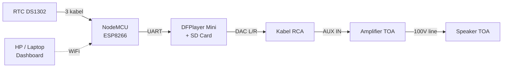
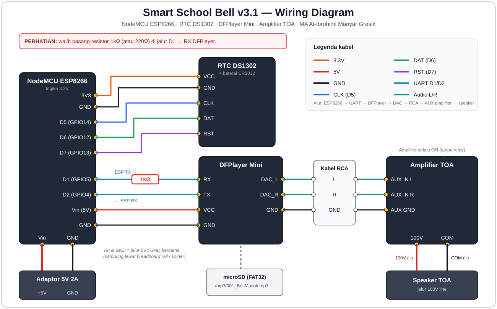

<div align="center">


# 🔔 Smart School Bell v3.1

**Bel sekolah otomatis berbasis NodeMCU ESP8266 + RTC DS1302 + DFPlayer Mini, tersambung ke amplifier TOA, dengan dashboard web untuk mengatur jadwal.**

Dibuat untuk **MA Al-Ibrohimi Manyar Gresik**

</div>

---

## ✨ Fitur

- ⏰ Bel berbunyi otomatis tepat di detik `:00` sesuai jadwal (waktu dari RTC DS1302, tetap akurat walau WiFi mati).
- 🌐 Dashboard web (dibuka dari HP/laptop di jaringan WiFi yang sama) untuk menambah/menghapus jadwal dan daftar suara.
- 🔊 Suara bel berupa file MP3 di SD card DFPlayer, bebas diganti (Bel Masuk, Istirahat, Pulang, Upacara, dst).
- 📅 Jadwal per hari (`Senin,Selasa,…`) atau `Semua`.
- ▶️ Tombol **TEST** untuk mencoba suara langsung dari dashboard.
- 💾 Jadwal & daftar suara tersimpan di flash (LittleFS), tidak hilang saat listrik padam.
- 📡 Jika WiFi gagal tersambung, otomatis membuat hotspot sendiri (`SmartBell_Setup`) agar tetap bisa diakses.

## 🧭 Cara kerja



NodeMCU membaca jam dari RTC tiap detik. Saat jam & hari cocok dengan jadwal, NodeMCU memerintahkan DFPlayer memutar file ke-N di SD card. Audio keluar lewat RCA ke input AUX amplifier TOA, lalu ke speaker. Amplifier dibiarkan selalu menyala (tanpa relay).

## 🧰 Komponen

| No | Komponen | Keterangan |
|----|----------|------------|
| 1 | NodeMCU ESP8266 (ESP-12E) | Mikrokontroler + WiFi + web server |
| 2 | RTC DS1302 + baterai CR2032 | Penyimpan waktu |
| 3 | DFPlayer Mini | Pemutar MP3 dari microSD |
| 4 | MicroSD ≤ 32GB (FAT32) | Menyimpan file suara bel |
| 5 | Resistor 1kΩ (atau 220Ω) | **Wajib**, di jalur D1 → RX DFPlayer |
| 6 | Kabel RCA (atau 3.5mm → RCA) | DFPlayer → amplifier |
| 7 | Amplifier TOA + speaker (100V line) | Output suara |
| 8 | Adaptor 5V 2A + kabel jumper / breadboard | Catu daya & koneksi |

## 🔌 Wiring Diagram



> Versi interaktif (HTML): [`docs/wiring-diagram-interaktif.html`](docs/wiring-diagram-interaktif.html) — unduh lalu buka di browser.

### Tabel koneksi

**RTC DS1302 → NodeMCU**

| RTC DS1302 | NodeMCU | Keterangan |
|-----------|---------|------------|
| VCC | 3V3 | Daya 3.3V |
| GND | GND | Ground |
| CLK | D5 (GPIO14) | Clock |
| DAT | D6 (GPIO12) | Data |
| RST | D7 (GPIO13) | Reset |

**DFPlayer Mini → NodeMCU**

| DFPlayer | NodeMCU | Keterangan |
|----------|---------|------------|
| VCC | Vin (5V) | Daya 5V |
| GND | GND | Ground |
| RX | D1 (GPIO5) | ⚠️ **lewat resistor 1kΩ** |
| TX | D2 (GPIO4) | Langsung |

**Audio**

| Dari | Ke |
|------|----|
| DFPlayer `DAC_L` | RCA L → `AUX IN L` amplifier |
| DFPlayer `DAC_R` | RCA R → `AUX IN R` amplifier |
| DFPlayer `GND` | RCA GND → ground AUX amplifier |
| Amplifier `100V` / `COM` | Speaker TOA (+) / (−) |

**Daya:** adaptor 5V 2A → pin `Vin` NodeMCU, dan `VCC` DFPlayer dari jalur 5V yang sama. Semua GND disatukan.

## 📁 Struktur repo

```
SmartSchoolBell/
├── README.md
├── docs/
│   ├── wiring-diagram.svg
│   └── wiring-diagram-interaktif.html
└── SmartSchoolBell/              ← folder sketch Arduino
    ├── SmartSchoolBell.ino       ← firmware utama
    └── data/                     ← di-upload ke LittleFS
        ├── index.html            ← dashboard web
        └── logo.png              ← logo sekolah
```

> Nama folder sketch **harus sama** dengan nama file `.ino` (`SmartSchoolBell`), kalau tidak Arduino IDE akan menolak membukanya.

## 🛠️ Langkah pemasangan hardware

> ⚠️ Lepas adaptor dari listrik selama merakit.

1. **Pasang RTC DS1302.** Masukkan baterai CR2032. Sambungkan `VCC→3V3`, `GND→GND`, `CLK→D5`, `DAT→D6`, `RST→D7`.
2. **Siapkan SD card.** Format **FAT32**, buat folder `mp3`, isi file dengan nama `001_Bel Masuk.mp3`, `002_Istirahat.mp3`, `003_Pulang.mp3`, dst. Penomoran harus mulai dari 001 dan tidak boleh melompat. Pasang ke DFPlayer.
3. **Pasang DFPlayer Mini.** `VCC→Vin(5V)`, `GND→GND`, `TX→D2`, dan `RX→D1` **melalui resistor 1kΩ**.
4. **Sambungkan audio.** `DAC_L`, `DAC_R`, `GND` DFPlayer ke kabel RCA, lalu colokkan ke input **AUX IN** amplifier TOA.
5. **Sambungkan amplifier ke speaker** dengan terminal `100V` (+) dan `COM` (−), sesuai spesifikasi speaker line 100V Anda.
6. **Cek ulang semua kabel** (terutama resistor, dan jangan sampai 5V masuk ke pin RTC/ESP selain `Vin`).
7. **Nyalakan** NodeMCU dengan adaptor 5V 2A (amplifier memakai power sendiri dan dibiarkan ON).

## 💻 Instalasi software

### 1. Siapkan Arduino IDE

1. Install [Arduino IDE](https://www.arduino.cc/en/software).
2. Buka *File → Preferences → Additional Boards Manager URLs*, tambahkan:
   ```
   http://arduino.esp8266.com/stable/package_esp8266com_index.json
   ```
3. *Tools → Board → Boards Manager* → cari **esp8266** → Install.
4. Pilih board **NodeMCU 1.0 (ESP-12E Module)**.
5. Pilih *Tools → Flash Size* dengan alokasi filesystem, mis. **4MB (FS:2MB OTA:~1019KB)**.

### 2. Install library (*Sketch → Include Library → Manage Libraries*)

| Library | Penulis |
|---------|---------|
| ArduinoJson **v6.x** | Benoit Blanchon |
| **Rtc** (menyediakan `RtcDS1302.h` & `ThreeWire.h`) | Michael C. Miller (Makuna) |
| DFRobotDFPlayerMini | DFRobot |

`ESP8266WiFi`, `ESP8266WebServer`, `LittleFS`, dan `SoftwareSerial` sudah bawaan core ESP8266.

### 3. Install plugin upload LittleFS

Pasang plugin [arduino-littlefs-upload](https://github.com/earlephilhower/arduino-littlefs-upload) (untuk Arduino IDE 2.x).

### 4. Isi WiFi

Buka `SmartSchoolBell.ino`, ubah:

```cpp
const char* WIFI_SSID     = "NAMA_WIFI_KAMU";
const char* WIFI_PASSWORD = "PASSWORD_WIFI_KAMU";
```

### 5. Set waktu RTC (sekali saja)

Di `setup()`, hilangkan komentar pada baris berikut, upload **sekali**, lalu beri komentar lagi dan upload ulang:

```cpp
rtc.SetIsWriteProtected(false);
rtc.SetIsRunning(true);
RtcDateTime compiled(__DATE__, __TIME__);
rtc.SetDateTime(compiled);
```

> Waktu yang diset adalah waktu komputer saat kompilasi, jadi pastikan jam komputer sudah benar (WIB) dan upload segera.

### 6. Upload firmware & file dashboard

1. Colok NodeMCU via USB, pilih port, klik **Upload** (sketch).
2. Upload isi folder `data/` ke LittleFS: tekan `Ctrl+Shift+P` → **"Upload LittleFS to Pico/ESP8266/ESP32"** (tutup Serial Monitor dulu).
3. Buka **Serial Monitor** (115200 baud) dan lihat alamat IP yang tampil.

### 7. Buka dashboard

Buka `http://<IP-yang-tampil>` dari HP/laptop di WiFi yang sama.

Jika WiFi gagal tersambung, NodeMCU membuat hotspot **`SmartBell_Setup`** (password `12345678`). Sambungkan ke hotspot itu lalu buka `http://192.168.4.1`.

## 📋 Cara memakai dashboard

1. **Daftar Suara SD Card** → isi **No. Index** (sesuai nomor file di SD, mis. `1`) dan **Nama Suara** (mis. `Bel Masuk`) → **Daftarkan**.
2. **Tambah jadwal** → pilih jam, hari aktif, dan suara dari dropdown → simpan.
3. Klik **▶ TEST** untuk mencoba suara.
4. Bel akan berbunyi otomatis tepat di detik `:00` pada jam yang dijadwalkan.

Contoh: `07:00 Senin–Jumat → Bel Masuk` dan `13:00 Semua → Pulang`.

## 🌐 API

| Method | Endpoint | Fungsi |
|--------|----------|--------|
| GET | `/api/status` | Jam, hari, IP, bel berikutnya |
| GET / POST | `/api/schedules` | Lihat / tambah jadwal |
| POST | `/api/delete` | Hapus jadwal `{"id":0}` |
| POST | `/api/test` | Putar suara `{"fileIndex":1}` |
| GET / POST | `/api/sounds` | Lihat / daftarkan suara |
| POST | `/api/sounds/delete` | Hapus suara `{"index":1}` |

## 🩺 Troubleshooting

| Masalah | Kemungkinan penyebab & solusi |
|---------|-------------------------------|
| `DFPlayer tidak terdeteksi` di Serial Monitor | Cek wiring RX/TX (jangan tertukar), resistor 1kΩ, SD card terpasang & FAT32, daya 5V cukup |
| Tidak ada suara | Cek kabel RCA ke AUX IN, volume amplifier, dan pilih input AUX |
| Suara yang keluar tidak sesuai | Pastikan penomoran file 001, 002, … tanpa lompat. Salin file ke SD satu per satu sesuai urutan |
| Dashboard kosong / `index.html tidak ditemukan` | Upload `data/` ke LittleFS belum dilakukan |
| Logo tidak muncul | `logo.png` belum ikut ter-upload ke LittleFS |
| Waktu salah / mundur ke 2000 | Set ulang RTC, cek baterai CR2032 |
| Bel tidak berbunyi | Cek hari & jam jadwal, dan pastikan jam RTC sudah benar |
| Gagal upload | Tutup Serial Monitor, pilih port & board yang benar |

## 🔒 Catatan keamanan

Dashboard **tidak memakai login**. Siapa pun di jaringan WiFi yang sama bisa mengubah jadwal. Pakai WiFi sekolah yang berpassword, jangan membuka port ke internet, dan ganti password hotspot `SmartBell_Setup` di sketch.

## 👤 Kredit

- Dibuat untuk **MA Al-Ibrohimi Manyar Gresik**
- Dikembangkan oleh **Kusuma Web** ([kusumaweb.cloud](https://kusumaweb.cloud))

## 📄 Lisensi

Tentukan lisensi sebelum dipublikasikan (mis. [MIT](https://choosealicense.com/licenses/mit/)).
